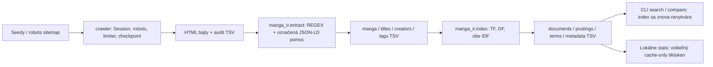

# Konzultácia 2b a prvé odovzdanie – MangaBaka IR

Stav overený **21. 10. 2026** po používateľovom väčšom zbere. Crawler získava
pôvodné HTML; všetky nasledujúce výstupy boli znovu vytvorené offline.
Tento súbor je podklad pre wiki, nie záznam jej publikovania.

## 1. Aktuálny rozsah a prostredie

| Ukazovateľ | Hodnota |
| --- | --- |
| HTTP pokusy celého data/ | 20 873 |
| Použiteľné unikátne HTML | 20 574: 20 573 detailov + 1 zoznam |
| HTML na disku vrátane historických verzií | 4 800 923 616 B = 4.800924 GB = 4.471209 GiB |
| Bajty obsahovo použiteľných HTML | 4 800 300 046 |
| Extrahované / indexované manga | 20 573 / 20 573 |
| Unikátne termy / postingy | 75 811 / 380 936 |
| Tokeny vlastného indexu | 451 401 |
| tiktoken cl100k_base | 1 185 990 |
| Referenčné reálne detaily vo fixtures | 20 |
| Offline testy | 59, všetky úspešné |

Poznáme 205 238 unikátnych manga ID: 20 573 získaných, 6 nedostupných a 184 659 čakajúcich. Celkom zostáva 184 668 URL vrátane 8 zoznamov. Získaný je sitemap index a všetkých 9 jeho URL setov, bez skrátenia limitom. **Pokrytie je stále čiastočné.**

Hranica **500 MB aj 500 MiB HTML je splnená**. Viac než milión manga záznamov zatiaľ získaných nie je. Bajty HTML zahŕňajú zachované historické verzie; venv, index, TSV a checkpointy sa do tohto čísla nezapočítavajú.

Vo fyzickej fronte je navyše 1 už úspešne uložený detail, ktorý sa pri prerušení nestihol potvrdiť checkpointom. Manifest ho počíta medzi získané, nie medzi zostávajúce; --resume ho obnoví lokálne bez opätovného HTTP.

### Prostredie

| Nástroj | Nainštalovaná verzia | Požiadavka/použitie |
| --- | --- | --- |
| Python | 3.14.6 | Projekt 3.10+, overené iba uvedené prostredie |
| requests | 2.34.2 | Priame requirements: >=2.32.5,<3 |
| tiktoken | 0.14.0 | Voliteľné requirements-bonus: >=0.8,<1 |
| regex | 2026.9.29 | Nepriama závislosť iba bonusu |

Python 3.10+ je požiadavka projektu; testované bolo uvedené konkrétne prostredie.
Requirements určujú rozsah, nie presné uzamknuté verzie. Tiktoken a jeho
závislosť regex sú voliteľné; vlastný vyhľadávací tokenizer používa štandardné
`re`. HTTP zabezpečuje requests.Session. XML parsuje štandardný
`xml.etree.ElementTree`, gzip štandardný modul gzip, TSV štandardný csv.
SQL/SQLite, pandas, NLTK, Scrapy ani vyhľadávací framework sa nepoužívajú.
Spark, Wikipedia join, PyLucene a webové UI sa neimplementovali.

### Manifest skutočného datasetu

Autoritatívny strojový manifest je `data/reports/dataset_manifest.tsv`; jeho aktuálna kópia je v `sample_outputs/reports/`.

| Ukazovateľ | Hodnota |
| --- | --- |
| scope | data |
| first_attempt_utc | 2026-10-12T07:53:39.532896+00:00 |
| last_attempt_utc | 2026-10-21T14:26:33.360056+00:00 |
| relevant_document | HTTP 200 HTML; primary manga detail /manga/<numeric_id>; canonical ID and title/H1; no recognized challenge or content preference gate |
| discovered_unique_manga_ids | 205238 |
| acquired_manga_ids | 20573 |
| unavailable_manga_ids | 6 |
| remaining_manga_ids | 184659 |
| duplicate_alias_ids | 0 |
| pending_manga_ids | 184660 |
| saved_manga_ids_pending_checkpoint | 1 |
| discovery_sources | legacy stored HTML, explicit seeds, /popular links, declared robots sitemap index and URL sets (when enabled) |
| sitemap_files_acquired | 10 |
| sitemap_files_remaining | 0 |
| sitemap_fetches_truncated | 0 |
| coverage | PARTIAL; acquired subset of discovered manga IDs; no complete-domain claim |

Časový interval uvádza prvý a posledný HTTP pokus celého zberu, nie nepretržitý čas sťahovania. Posledný dôvod ukončenia je `interrupted`; v pending zostávajú aj štyri dočasné ConnectionError. Listy nie sú manga záznamy.

## 2. Crawler, sitemapy a obsahové preferencie

Zachované sú requests.Session, vlastný href REGEX, HTTPS/presný hostname,
ID deduplikácia, pôvodné bajty HTML, audit každého requestu, generačné
checkpointy, Ctrl+C a resume, robots, timeouty, náhodná pauza a retry.

Predvolené hlavičky sú `User-Agent: MangaIRStudentBot/0.1`,
`Accept: text/html,application/xhtml+xml;q=0.9`, `Accept-Language: en`.
Connection timeout je 5 s, read timeout 30 s medzi čítaniami, nie celkový
čas stiahnutia. Sekvenčný downloader čaká náhodne 3–5 s po dokončení requestu;
prísnejší Crawl-delay/Request-rate má prednosť. Časovanie je monotónne,
UTC iba audit/restart bridge. Timeout/spojenie/5xx má najviac 2 dodatočné
pokusy s pauzami ≥10 a ≥30 s. 429 podporuje Retry-After sekundy/dátum,
fallback 60 s; druhý výskyt pozastaví. 403 sa neopakuje, druhá pozastaví;
404 sa neopakuje. Ručné redirecty majú default limit 5 a každá URL sa kontroluje
pred requestom. Žiadne blokovanie sa neobchádza.

Povolené HTML cesty sú detaily `/manga/<id>[/slug]`, list `/popular` s jediným
parametrom `page=1..500` a kandidátny `/search`, ktorý uložený robots zakazuje.
Arbitrárne filtre/query, externé domény, kapitoly, obálky a karty detailov sú
odmietnuté. Ani limit 500 list stránok nie je dôkaz úplného pokrytia.

### Získané sitemap súbory

| URL | Typ | UTC | XML položky | Prijaté URL | Truncated | Bajty |
| --- | --- | --- | --- | --- | --- | --- |
| https://mangabaka.org/sitemap.xml | sitemapindex | 2026-10-19T12:02:21.015285+00:00 | 9 | 9 | false | 1082 |
| https://mangabaka.org/sitemap/giech1aigee4eiseeJob9ubie7Xo5K/sitemap-8.xml.gz | urlset | 2026-10-19T12:02:25.041375+00:00 | 5267 | 2113 | false | 166111 |
| https://mangabaka.org/sitemap/giech1aigee4eiseeJob9ubie7Xo5K/sitemap-7.xml.gz | urlset | 2026-10-19T14:33:20.278812+00:00 | 50000 | 29767 | false | 1506594 |
| https://mangabaka.org/sitemap/giech1aigee4eiseeJob9ubie7Xo5K/sitemap-6.xml.gz | urlset | 2026-10-19T14:33:25.135460+00:00 | 50000 | 31211 | false | 1448740 |
| https://mangabaka.org/sitemap/giech1aigee4eiseeJob9ubie7Xo5K/sitemap-5.xml.gz | urlset | 2026-10-19T14:33:29.869241+00:00 | 50000 | 25240 | false | 1442745 |
| https://mangabaka.org/sitemap/giech1aigee4eiseeJob9ubie7Xo5K/sitemap-4.xml.gz | urlset | 2026-10-19T14:33:34.568336+00:00 | 50000 | 25650 | false | 1414825 |
| https://mangabaka.org/sitemap/giech1aigee4eiseeJob9ubie7Xo5K/sitemap-3.xml.gz | urlset | 2026-10-19T14:33:39.140350+00:00 | 50000 | 26138 | false | 1404251 |
| https://mangabaka.org/sitemap/giech1aigee4eiseeJob9ubie7Xo5K/sitemap-2.xml.gz | urlset | 2026-10-19T14:33:42.552128+00:00 | 50000 | 25322 | false | 1339559 |
| https://mangabaka.org/sitemap/giech1aigee4eiseeJob9ubie7Xo5K/sitemap-1.xml.gz | urlset | 2026-10-19T14:33:46.532358+00:00 | 50000 | 23500 | false | 1168225 |
| https://mangabaka.org/sitemap/giech1aigee4eiseeJob9ubie7Xo5K/sitemap-0.xml.gz | urlset | 2026-10-19T14:33:50.602454+00:00 | 50000 | 16297 | false | 947649 |

Všetkých 9 deklarovaných URL setov je spracovaných, bez skrátenia. Relevantné
ID z XML sa deduplikujú s HTML objavovaním. Spracovanie sitemap ešte neznamená
stiahnutie všetkých detailov: pending fronta zostáva veľká. XML requesty sa
auditujú a započítavajú do HTTP limitu, ale nie do počtu manga dokumentov.
Parser používa ElementTree/gzip, podporuje namespaces, odmieta DTD/entities
a XML nad 50 MiB po rozbalení. Objavené URL podliehajú doméne, scope a robots.

### Explicitná cookie a opakovaný zber

`--content-ratings pornographic,safe,suggestive,erotica` nastaví doménovú HTTPS
cookie `content_rating=pornographic%2Csafe%2Csuggestive%2Cerotica`.
Hodnota je uložená v control.tsv a musí sa uvádzať pri každom spustení.
Prepínač `--retry-content-filtered` spolu s `--resume` vráti iba predtým
filtrované tituly do fronty. Neobnovuje ostatné permanentné chyby a nemení
robots, pacing, 403/429 ani challenge kontroly. Ak sa brána stále zobrazí,
HTML sa odmietne. Historické chyby v audite zostávajú aj po úspešnom opakovaní.

Pri inom obsahu rovnakého ID vznikne nový HTML súbor s hashom v názve;
starý snapshot a jeho audit sa zachovajú. Resume aj extrakcia vyberajú posledný
uložený úspešný pokus. Staršia obsahová brána neprepíše novší úspešný stav.

### Overenie integrity a chýb

| Typ | Počet HTTP pokusov s chybou |
| --- | --- |
| ConnectionError | 53 |
| HTTP 502 | 10 |
| ReadTimeout | 21 |
| content_filtered | 170 |
| unsafe_redirect | 6 |

Počty sú kumulatívne pokusy, nie počet momentálne nedostupných titulov. Audit zachovaných HTML: 20 578 súborov, 20 574 použiteľných, odmietnuté historické snapshoty podľa typu: {'content_filtered': 4}. Počet poškodených/chýbajúcich aktuálnych HTML v štatistike: 0. Offline audit sa spustil bez --repair-state a nemenil crawler stav ani HTML.

## 3. REGEX extraktor nad skutočnými vzorkami

Modul `manga_ir/extract.py` číta súbory offline po jednom. Pri celom datasete
vyberá detailné úspešné záznamy z HTTP auditu, overí súbor/hash/veľkosť a pre ID
vytvorí jeden scalar záznam. Ochranné a obsahovo filtrované stránky končia v
extraction_errors.tsv. Listy sa do manga.tsv nedostávajú. HTML sa nikdy nemení.

Pozorované SSR vzory: hlavný H1, jazykové divy v primárnom headeri,
`section aria-label="Description"`, meta aria-label atribúty typu
`Series has ... chapters`, staff odkazy a `data-tag-id`/aria-label na tagoch.
Scope končí pred odporúčaniami; všeobecný export všetkého textu stránky sa nepoužíva.

### Doslovné ukážky aktuálneho kódu

Konštanty v `manga_ir/extract.py`:

```python
H1_RE = re.compile(r'<h1\b[^>]*>(.*?)</h1\s*>', re.I | re.S)
DESCRIPTION_RE = re.compile(r'<section\b[^>]*\baria-label=[\'"]Description[\'"][^>]*>(.*?)</section\s*>', re.I | re.S)
ANCHOR_RE = re.compile(r'<a\b([^>]*)>(.*?)</a\s*>', re.I | re.S)
LANG_TITLE_RE = re.compile(r'<div\b[^>]*\blang=[\'"]([^\'"]+)[\'"][^>]*>(.*?)</div\s*>', re.I | re.S)
```

Čistenie `clean_text`:

```python
def clean_text(value):
    value = re.sub(r'<(?:br\b[^>]*|/p\s*|/div\s*|hr\b[^>]*)>', ' ', value, flags=re.I)
    return re.sub(r'\s+', ' ', unescape(re.sub(r'<[^>]*>', ' ', value))).strip()
```

Výrez funkcie `extract_html`: primárny scope, meta labely a skalárne polia:

```python
    heading = H1_RE.search(dom)
    if not heading or not clean_text(heading[1]):
        raise ValueError('missing_title')
    title = clean_text(heading[1])
    if re.match(r'(?:404|403|error|not found|sign in|access denied)\b', title, re.I):
        raise ValueError('error_document')
    # Primary header/meta precede Description; recommendations follow the main Tags.
    description = DESCRIPTION_RE.search(dom, heading.end())
    meta_end = description.start() if description else dom.find('<h2', heading.end())
    if meta_end < 0:
        meta_end = len(dom)
    meta = dom[heading.start():meta_end]
    labels = [attrs(tag).get('aria-label', '') for tag in OPEN_TAG_RE.findall(meta)]
    def label(pattern):
        return next((m[1] for v in labels if (m := re.fullmatch(pattern, v))), '')
    years = next((m for v in labels if (m := re.fullmatch(r'Published ([0-9]{4})(?:\s*-\s*([0-9]{4}))?', v))), None)
    scalar = dict.fromkeys(MANGA_FIELDS, '')
    scalar.update(manga_id=target.manga_id, title=title,
                  description=clean_text(description[1]) if description else '',
                  work_type=label(r'Published as (.+)'), status=label(r'Series is (releasing|completed|hiatus|cancelled|upcoming|unknown)'),
                  start_year=years[1] if years else '', end_year=(years[2] or '') if years else '',
                  chapters=label(r'Series has ([0-9]+) chapters?'), volumes=label(r'Series has ([0-9]+) volumes?'),
                  source_url=canonical_target.url, html_path=html_path, html_sha256=hashlib.sha256(raw).hexdigest())
    if scalar['description'] == 'No description available for this series.':
        scalar['description'] = ''
    result = Manga(scalar)
```

### Pomocný JSON-LD zdroj je explicitne oddelený

**Nie je to obyčajný export JSON.** Title, opis, status, roky, počty, typ a
žánre/témy sa extrahujú REGEX z DOM. Mená tvorcov sa REGEX čítajú zo staff
odkazov. Štruktúrované dáta dopĺňajú iba alternatívne názvy, ktoré SSR hlavička
skrýva za tlačidlom, a explicitné author/illustrator role k týmto menám.
Keď sa rola nedá doložiť, zostáva unknown; neodhaduje sa podľa mena.
Pôvod viacnásobných hodnôt je uložený v origin stĺpci.

Použitá funkcia `matching_jsonld` z toho istého súboru vyberá iba ComicSeries
s presne zhodným MangaBaka identifier, nie breadcrumb alebo odporúčané dielo:

```python
def matching_jsonld(raw, manga_id):
    """Auxiliary role/alternate-title source, selected by exact identifier, not name."""
    for match in re.finditer(r'<script\b([^>]*)>(.*?)</script\s*>', raw, re.I | re.S):
        if attrs(match[1]).get('type') != 'application/ld+json':
            continue
        try:
            item = json.loads(match[2])
        except (ValueError, TypeError):
            continue
        if not isinstance(item, dict) or item.get('@type') != 'ComicSeries':
            continue
        identity = item.get('identifier', {})
        if isinstance(identity, dict) and identity.get('propertyID') == 'mangabaka' and str(identity.get('value')) == manga_id:
            return item
    return {}
```

Pri chýbajúcom poli zostáva prázdna hodnota. Neznámy počet sa nemení na nulu.
Explicitný enum status unknown sa zachová ako hodnota zdroja; netvrdí sa, že
poznáme stav vydávania. Jazyk pri doplnenej JSON-LD alternatíve zostáva prázdny,
ak ho zdroj k tejto alternatíve neposkytuje.

### Päť reálnych ukážok extrakcie

| ID | Hlavný titul | URL | Tvorcovia a role | Stav | Roky | Kapitoly | Zväzky | Ukážka alternatív |
| --- | --- | --- | --- | --- | --- | --- | --- | --- |
| 676 | Ichi the Witch | https://mangabaka.org/manga/676/Ichi-the-Witch | author: Osamu Nishi; illustrator: Shiro Usazaki | releasing | 2024 | 101 | 10 | Madan no Ichi; 魔男のイチ; 마남 이치; Czarownik Ichi; Ichi, el brujo.; Ichi, o Bruxo; Phù thuỷ Ichi; Ведьмак Ити; Відьма Ічі; जादूगर इचि; พ่อมดอิจิ; 魔男伊奇 |
| 1824 | DEATH NOTE | https://mangabaka.org/manga/1824/DEATH-NOTE | author: Tsugumi Ooba; illustrator: Takeshi Obata | completed | 2003–2006 | 108 | 12 | 데스노트; Beležnica smrti; Bilježnica smrti; Caietul morții; Cuaderno de la Muerte; Death Note; Death Note - A halállista; Death Note - Zápisník smrti; Death Note: Тетрадка на смъртта; |
| 4024 | ATTACK ON TITAN | https://mangabaka.org/manga/4024/ATTACK-ON-TITAN | author: Hajime Isayama; illustrator: Hajime Isayama | completed | 2009–2021 | 141 | 34 | Shingeki no Kyojin; 進撃の巨人; 진격의 거인; Attack on Titan; Atac als Titans; Atacul Titanilor; Napad Titana; Ataque a los Titanes; Ataque de los Titanes; Ataque dos Titãs; Đại Chiến Người  |
| 328133 | Single Mothers | https://mangabaka.org/manga/328133/Single-Mothers | author: FUJITA Motoko; illustrator: FUJITA Motoko | completed | 2023 | ∅ | 5 | Single Mother-tachi; シングルマザーたち |
| 591006 | Mishima Junichirou ga, Watashi no Kekkon o Mitomenai. | https://mangabaka.org/manga/591006/Mishima-Junichirou-ga-Watashi-no-Kekkon-o-Mitomenai | author: KATSURA Tamami; illustrator: KATSURA Tamami | unknown | 2026 | ∅ | ∅ | 三島潤一郎が、私の結婚を認めない。 |

Zoznam alternatív v ukážke je skrátený; úplné hodnoty, role a origin sú v TSV.
Prázdne polia posledných dvoch ukážok sú zámerné overené chýbajúce údaje.

## 4. Referenčné testy na 20 reálnych detailoch

`tests/fixtures/reference.tsv` bol kurátorovaný z H1, relevantných aria-label,
staff odkazov a zodpovedajúceho JSON-LD v uloženom HTML. Očakávania sa
**nevytvárali spustením testovaného extraktora**. Zdrojové URL, pôvodný UTC čas
a SHA-256 každého plného HTML sú priložené v reference TSV aj v pôvodnom
auditnom výbere `tests/fixtures/source_metadata.tsv`.

| ID | Ručne overený titul | Stav | Chapters / volumes | URL | SHA-256 pôvodného HTML |
| --- | --- | --- | --- | --- | --- |
| 377 | ONE PIECE | releasing | 1195 / 115 | https://mangabaka.org/manga/377/ONE-PIECE | a85937db1e72635c28d76a9e46e9bb29564911eccc7754ed85334663cf37ec31 |
| 676 | Ichi the Witch | releasing | 101 / 10 | https://mangabaka.org/manga/676/Ichi-the-Witch | fc209931f70506c8563a4fb5c30428243f9fafe792a7cfab53b1bd9422d85804 |
| 677 | HUNTER×HUNTER | hiatus | 420 / 39 | https://mangabaka.org/manga/677/HUNTER-HUNTER | 7e74a4c0b5b88c7359f53c6b5b50b27a2c5846f460d07eb4e65bcd0477761158 |
| 725 | ONE-PUNCH MAN | releasing | 238 / 37 | https://mangabaka.org/manga/725/ONE-PUNCH-MAN | 67e67d5646b98b113958dcca3fe25b48c15b4fbace964f78de31ac7ae1aa95b0 |
| 849 | The Ancient Magus' Bride | releasing | 120 / 25 | https://mangabaka.org/manga/849/The-Ancient-Magus-Bride | 39a189d388c6a628e78a1aff8b1214e7ecc679992e096906876b38a2c1d67f14 |
| 1677 | Chainsaw Man | completed | 232 / 24 | https://mangabaka.org/manga/1677/Chainsaw-Man | 4f41e3070e43db703564d451d6476c4072707dabaedace444bbe95fe4d7ab976 |
| 2813 | TOKYO GHOUL | completed | 144 / 14 | https://mangabaka.org/manga/2813/TOKYO-GHOUL | 64157b72823b845a05e02c28e441140c6e4a13c023296028ce4d2f5a6305af89 |
| 4024 | ATTACK ON TITAN | completed | 141 / 34 | https://mangabaka.org/manga/4024/ATTACK-ON-TITAN | 18ab5e7433f9937efe696d5c2b949c639484cc95ad619114a597f00ecbc16687 |
| 6199 | Jujutsu Kaisen | completed | 272 / 30 | https://mangabaka.org/manga/6199/Jujutsu-Kaisen | 74fd854f403f9dc27cf9932f8229818948efff39de4d9add5c9ec2cc667d9a0c |
| 6029 | Horimiya | completed | 152 / 17 | https://mangabaka.org/manga/6029/Horimiya | 8e120511a22c877449f5d323c7875481c7bb06412160049087bda3c42db60bc7 |
| 2410 | BLEACH | completed | 706 / 74 | https://mangabaka.org/manga/2410/BLEACH | 9bb8000b4e0d5df0689c350dfe1933387a2e3d4be797c562c18fd941267f6f2a |
| 3403 | Demon Slayer: Kimetsu no Yaiba | completed | 207 / 23 | https://mangabaka.org/manga/3403/Demon-Slayer-Kimetsu-no-Yaiba | 30f2c26d481718edc20e9e22b92cd39950c870e402af50b9060a3970aab74b15 |
| 7423 | MY HERO ACADEMIA | completed | 432 / 42 | https://mangabaka.org/manga/7423/MY-HERO-ACADEMIA | 7270eff7bc00a95ac63753f2ac43f56291abd4cf37744a5c812a47e675a9ea50 |
| 1824 | DEATH NOTE | completed | 108 / 12 | https://mangabaka.org/manga/1824/DEATH-NOTE | 900fd4dece3f7539d3e1632c3063e1516c19566b5142493d0cd0b2445dbf5295 |
| 8312 | FULLMETAL ALCHEMIST | completed | 158 / 27 | https://mangabaka.org/manga/8312/FULLMETAL-ALCHEMIST | 60731f6e57f93559e999121fc30d7a7e85ee3604db931d4abd3204d0c42bb45c |
| 6367 | A Silent Voice | completed | 64 / 7 | https://mangabaka.org/manga/6367/A-Silent-Voice | 2ec7d74b1aa87c7e57a397139b5fd1d76993a9e00c29ee621e0292b71ef63dc9 |
| 1288 | SPY×FAMILY | releasing | 141 / 17 | https://mangabaka.org/manga/1288/SPY-FAMILY | 174e2903c78ee07742f648f2e39e1f537f74f6fbc873d35a5156dbcb2db8469e |
| 521697 | Saigo no Yuki | releasing | 2 / ∅ | https://mangabaka.org/manga/521697/Saigo-no-Yuki | e8b40ca612e69cdb85bd620c5f28af74e2284e9c4dc4f11a4f4aaded523e4ea2 |
| 328133 | Single Mothers | completed | ∅ / 5 | https://mangabaka.org/manga/328133/Single-Mothers | 24f4518bc1b441edca556e1c4632673ef5cd872238f58317f91709256fe84cc3 |
| 591006 | Mishima Junichirou ga, Watashi no Kekkon o Mitomenai. | unknown | ∅ / ∅ | https://mangabaka.org/manga/591006/Mishima-Junichirou-ga-Watashi-no-Kekkon-o-Mitomenai | b8fedf19285f4d772fff8d4651f9d7cbdbef729b1c2dbc55beb60a0dadcd6f88 |

Fixtures sú gzip kópie celých pôvodných bajtov, bez redukcie a úprav markup.
Test kontroluje SHA dekomprimovaných bajtov, presné title/ID/type/status,
roky a kapitoly/zväzky vrátane prázdnych polí, presné mená a role tvorcov,
vybrané japonské alternatívy, konkrétny žáner a kontrolné slovo opisu alebo
jeho overenú neprítomnosť. Nekontroluje iba neprázdnosť.

Vzorka obsahuje oddelené author/illustrator role, japončinu, × a apostrof,
pokračujúce/dokončené/hiatus/unknown stavy aj chýbajúce counts/opis. Ostatné
extrahované alternatívy a všetky tematické značky nemajú ručne anotovanú
úplnú referenciu; toto obmedzenie sa nezamlčuje.

## 5. Vlastný invertovaný index



Deterministický text má pevné poradie title, alternatívy, tvorcovia, opis,
žánre a témy. Rovnaké hodnoty s NFC/casefold kľúčom sa vložia iba raz,
oddelené newline. Rovnaký tvorca s oboma rolami sa nezapočíta dvakrát.
Všetky polia majú rovnakú váhu; titul sa umelo neopakuje.

Skutočný `manga_ir/text.py: compose_text`:

```python
def compose_text(scalar, titles=(), creators=(), tags=()):
    """Equal field weight; distinct values once, fixed order, no title repetition."""
    values = [scalar.get('title', '')]
    values += [row['title'] for row in titles]
    values += [row['name'] for row in creators]
    values += [scalar.get('description', '')]
    values += [row['name'] for row in tags if row['kind'] == 'genre']
    values += [row['name'] for row in tags if row['kind'] == 'theme']
    seen, result = set(), []
    for value in values:
        key = normalize(value.strip())
        if key and key not in seen:
            seen.add(key)
            result.append(value.strip())
    return '\n'.join(result)
```

Tokenizácia pre dokumenty aj dopyty je tá istá: HTML entity → Unicode NFC →
casefold → vlastné `re` sekvencie písmen/číslic bez underscore (`[^\W_]+`).
Bez stemmingu a stopslov. Japončina bez medzier môže zostať jedným termom,
preto nejde o segmentáciu slov pre japončinu ani substring search.

TSV sa čítajú streamom a pomocné tabuľky merge-joinom po numericky zoradenom
manga ID. Neprebieha hromadné načítanie pôvodných HTML. Jeden dokument vytvorí
Counter TF; slovník term → document_id → TF ostáva v RAM. Na aktuálnych 20 573 dokumentoch
a 380 936 postingoch bolo zostavenie aj načítanie úspešne overené. Čiastkové diskové indexy a external merge
pre veľkú kolekciu sa zatiaľ neimplementovali. Search načíta hotový index raz.

Prázdny indexovateľný text sa nezaradí do N a zaznamená sa do skipped_documents.tsv.
N teda nie je počet listov ani počet ľubovoľných HTML odpovedí.

### Schémy TSV

Všetky sú UTF-8 csv s tabulátorom a quotingom. Nasledujúce hlavičky sú priamo
z aktuálnych súborov; newline v texte nie je nový logický TSV riadok.

| Súbor | Presná postupnosť polí (v súbore oddelené tabulátormi) |
| --- | --- |
| data/crawl_metadata.tsv | requested_url, final_url, manga_id, fetched_at_utc, http_status, content_type, saved_bytes, html_path, sha256, attempt, error |
| data/pending_urls.tsv | key, url, state, transient_failures, not_before_utc, error |
| data/processed_urls.tsv | key, url, final_url, state, manga_id, html_path, saved_bytes, sha256, error |
| data/control.tsv | name, value |
| data/checkpoint.tsv | generation |
| data/discovery.tsv | key, url, method, source_url, discovered_at_utc |
| data/sitemap_metadata.tsv | url, fetched_at_utc, path, saved_bytes, sha256, kind, entries, accepted_urls, truncated |
| data/extracted/manga.tsv | manga_id, title, description, work_type, status, start_year, end_year, chapters, volumes, source_url, html_path, html_sha256 |
| data/extracted/titles.tsv | manga_id, title, language, origin |
| data/extracted/creators.tsv | manga_id, name, role, origin |
| data/extracted/tags.tsv | manga_id, name, kind, tag_id, origin |
| data/extracted/extraction_errors.tsv | html_path, source_url, error |
| data/extracted/field_coverage.tsv | field, filled, total |
| data/index/documents.tsv | document_id, manga_id, title, source_url, token_count, text_sha256, text |
| data/index/postings.tsv | term, document_id, tf |
| data/index/terms.tsv | term, df, idf_classic, idf_smooth |
| data/index/index_metadata.tsv | name, value |
| data/index/skipped_documents.tsv | manga_id, reason |
| data/query_comparison.tsv | query, method, rank, manga_id, title, score, source_url |
| data/reports/statistics.tsv | name, value |
| data/reports/dataset_manifest.tsv | name, value |
| data/reports/html_validation.tsv | source_url, manga_id, html_path, sha256, usable, error |
| data/reports/tiktoken_counts.tsv | document_id, manga_id, encoding, token_count, text_sha256 |
| data/reports/tiktoken_metadata.tsv | name, value |

index_metadata.tsv má name/value položky: verzia formátu, N, počty termov a
postingov, skipped_empty, normalizácia, tokenizer, poradie/váha polí, vzorce,
SHA vstupných extrakčných súborov a SHA indexových súborov. Document_id je
manga ID. Documents.tsv uchováva aj originálny deterministický text a jeho SHA,
aby bonus počítal presne rovnaký vstup pred tokenizačnou normalizáciou.

Pri načítaní sa overuje formát, hash súborov, schémy, unikátnosť ID/termov,
platné TF/DF, obe IDF, N a súčty. Poškodený/nekompatibilný index sa odmietne
zrozumiteľnou chybou. Indexové metadáta sa publikujú až po súboroch; prerušené
publikovanie sa odhalí nesúladom hashov, nie ignorovaním chyby.

## 6. Dve IDF a skórovanie

```text
TF(t,d) = počet výskytov termu t v dokumente d
DF(t)   = počet rôznych dokumentov obsahujúcich t
idf_classic(t) = ln(N / DF(t))
idf_smooth(t)  = ln((N + 1) / (DF(t) + 1)) + 1

score(d,q) = sum((1 + ln(TF(t,d))) * idf(t)
                 pre unikátne známe termy q prítomné v d)
```

Používa sa prirodzený logaritmus. Neznáme termy sa preskočia; nepočíta sa
DF=0. Kandidáti sú OR zjednotenie postingov, aj pri nulovom classic skóre.
Rovnaké skóre rozhodne numerické manga ID. Opakovaním termu v dopyte sa
nezvyšuje jeho váha. Prázdny dopyt má chybu, neznáme termy prázdny výsledok
s vysvetlením. Meno metódy a top-k sa validujú.

Skutočný kód `manga_ir/index.py: idfs` a `Index.search`:

```python
def idfs(n, df):
    if not 1 <= df <= n:
        raise ValueError('IDF vyžaduje 1 <= DF <= N.')
    return math.log(n / df), math.log((n + 1) / (df + 1)) + 1
```

```python
    def search(self, query, method='classic', top_k=10):
        if method not in {'classic', 'smooth'} or top_k < 1:
            raise ValueError('IDF musí byť classic/smooth a top-k kladné.')
        query_terms = set(tokenize(query))
        if not query_terms:
            raise ValueError('Prázdny dopyt: zadajte aspoň jedno písmeno alebo číslo.')
        scores = defaultdict(float)
        for term in sorted(query_terms):
            if term not in self.terms:
                continue
            weight = self.terms[term][1 if method == 'classic' else 2]
            for doc, tf in self.postings[term].items():
                scores[doc] += (1 + math.log(tf)) * weight
        ordered = sorted(scores, key=lambda doc: (-scores[doc], int(self.documents[doc]['manga_id'])))[:top_k]
        return [dict(rank=rank, manga_id=doc, title=self.documents[doc]['title'], score=scores[doc],
                     source_url=self.documents[doc]['source_url']) for rank, doc in enumerate(ordered, 1)]
```

Ručne kontrolovaný malý testový korpus má dokumenty 2=`all cat cat dog`,
10=`all dog`, 11=`all bird` a prázdny tokenový dokument 12=`___`.
N=3, TF(cat,2)=2, DF(cat)=1, DF(dog)=2, DF(all)=3. Test porovná presné
vzorce oboch IDF a skóre dopytu cat dog. Classic pre all má skóre 0 a stále
vráti všetky tri zhody v poradí 2,10,11. Overujú sa aj duplicity query,
neznáme termy, prázdny korpus a poškodený/nekompatibilný index.

## 7. Päť viacslovných dopytov na novom indexe

Použitý je index **N=20 573**, top-k=10, obe IDF. Úplné skutočné výsledky sú v `data/query_comparison.tsv` a `sample_outputs/query_comparison.tsv`.

### Dopyt: magic fantasy

| Metóda | Poradie | ID | Titul | Skóre | URL |
| --- | --- | --- | --- | --- | --- |
| classic | 1 | 676 | Ichi the Witch | 22.460632 | https://mangabaka.org/manga/676/Ichi-the-Witch |
| classic | 2 | 602341 | Kaijoshi Kanna no Memoir | 16.597710 | https://mangabaka.org/manga/602341/Kaijoshi-Kanna-no-Memoir |
| classic | 3 | 602393 | Isekai Fantasy wa Kusasugiru | 16.292752 | https://mangabaka.org/manga/602393/Isekai-Fantasy-wa-Kusasugiru |
| classic | 4 | 605100 | Ignite Eight | 16.292752 | https://mangabaka.org/manga/605100/Ignite-Eight |
| classic | 5 | 577734 | Misty Magic ~Princess Knightess Enthralled by a Futanari Spell~ | 16.241406 | https://mangabaka.org/manga/577734/Misty-Magic-Princess-Knightess-Enthralled-by-a-Futanari-Spell |
| classic | 6 | 8312 | FULLMETAL ALCHEMIST | 14.321329 | https://mangabaka.org/manga/8312/FULLMETAL-ALCHEMIST |
| classic | 7 | 32909 | The Mage of Basilico | 14.321329 | https://mangabaka.org/manga/32909/The-Mage-of-Basilico |
| classic | 8 | 567633 | The Underdog Magical Girl's Romantic Reversal: Even Though I'm a Troubled Underachiever at Magic School, the Unparalleled Genius Wizard is Head Over Heels and Obsessed, and It's a Real Problem | 14.321329 | https://mangabaka.org/manga/567633/The-Underdog-Magical-Girl-s-Romantic-Reversal-Even-Though-I-m-a-Troubled-Underachiever-at |
| classic | 9 | 328986 | The Oblivious Captain is Doted On By the Sadistic Knight Commander Through Mating Magic | 13.397245 | https://mangabaka.org/manga/328986/The-Oblivious-Captain-is-Doted-On-By-the-Sadistic-Knight-Commander-Through-Mating-Magic |
| classic | 10 | 7983 | FAIRY TAIL | 12.349907 | https://mangabaka.org/manga/7983/FAIRY-TAIL |
| smooth | 1 | 676 | Ichi the Witch | 27.599967 | https://mangabaka.org/manga/676/Ichi-the-Witch |
| smooth | 2 | 602341 | Kaijoshi Kanna no Memoir | 20.360444 | https://mangabaka.org/manga/602341/Kaijoshi-Kanna-no-Memoir |
| smooth | 3 | 602393 | Isekai Fantasy wa Kusasugiru | 20.347973 | https://mangabaka.org/manga/602393/Isekai-Fantasy-wa-Kusasugiru |
| smooth | 4 | 605100 | Ignite Eight | 20.347973 | https://mangabaka.org/manga/605100/Ignite-Eight |
| smooth | 5 | 577734 | Misty Magic ~Princess Knightess Enthralled by a Futanari Spell~ | 19.595423 | https://mangabaka.org/manga/577734/Misty-Magic-Princess-Knightess-Enthralled-by-a-Futanari-Spell |
| smooth | 6 | 8312 | FULLMETAL ALCHEMIST | 17.683948 | https://mangabaka.org/manga/8312/FULLMETAL-ALCHEMIST |
| smooth | 7 | 32909 | The Mage of Basilico | 17.683948 | https://mangabaka.org/manga/32909/The-Mage-of-Basilico |
| smooth | 8 | 567633 | The Underdog Magical Girl's Romantic Reversal: Even Though I'm a Troubled Underachiever at Magic School, the Unparalleled Genius Wizard is Head Over Heels and Obsessed, and It's a Real Problem | 17.683948 | https://mangabaka.org/manga/567633/The-Underdog-Magical-Girl-s-Romantic-Reversal-Even-Though-I-m-a-Troubled-Underachiever-at |
| smooth | 9 | 328986 | The Oblivious Captain is Doted On By the Sadistic Knight Commander Through Mating Magic | 15.752049 | https://mangabaka.org/manga/328986/The-Oblivious-Captain-is-Doted-On-By-the-Sadistic-Knight-Commander-Through-Mating-Magic |
| smooth | 10 | 7983 | FAIRY TAIL | 15.019924 | https://mangabaka.org/manga/7983/FAIRY-TAIL |

### Dopyt: school romance

| Metóda | Poradie | ID | Titul | Skóre | URL |
| --- | --- | --- | --- | --- | --- |
| classic | 1 | 6367 | A Silent Voice | 12.207452 | https://mangabaka.org/manga/6367/A-Silent-Voice |
| classic | 2 | 7423 | MY HERO ACADEMIA | 11.240796 | https://mangabaka.org/manga/7423/MY-HERO-ACADEMIA |
| classic | 3 | 1288 | SPY×FAMILY | 10.956101 | https://mangabaka.org/manga/1288/SPY-FAMILY |
| classic | 4 | 6029 | Horimiya | 10.956101 | https://mangabaka.org/manga/6029/Horimiya |
| classic | 5 | 361345 | Playboy and His Lovenest Romance. All He Wants Is a Reward from The Class President. (Official) | 10.544822 | https://mangabaka.org/manga/361345/Playboy-and-His-Lovenest-Romance-All-He-Wants-Is-a-Reward-from-The-Class-President |
| classic | 6 | 602092 | The Two of Us Can't Stay Mobs | 10.264164 | https://mangabaka.org/manga/602092/The-Two-of-Us-Can-t-Stay-Mobs |
| classic | 7 | 206059 | The Price of a Kiss | 9.783381 | https://mangabaka.org/manga/206059/The-Price-of-a-Kiss |
| classic | 8 | 598359 | After School S and M | 9.783381 | https://mangabaka.org/manga/598359/After-School-S-and-M |
| classic | 9 | 323415 | Gyokusai kara Hajimaru Koi | 9.091444 | https://mangabaka.org/manga/323415/Gyokusai-kara-Hajimaru-Koi |
| classic | 10 | 326423 | Watashi janakute mo Itoshite | 9.091444 | https://mangabaka.org/manga/326423/Watashi-janakute-mo-Itoshite |
| smooth | 1 | 6367 | A Silent Voice | 17.094494 | https://mangabaka.org/manga/6367/A-Silent-Voice |
| smooth | 2 | 7423 | MY HERO ACADEMIA | 15.316848 | https://mangabaka.org/manga/7423/MY-HERO-ACADEMIA |
| smooth | 3 | 1288 | SPY×FAMILY | 15.255632 | https://mangabaka.org/manga/1288/SPY-FAMILY |
| smooth | 4 | 6029 | Horimiya | 15.255632 | https://mangabaka.org/manga/6029/Horimiya |
| smooth | 5 | 361345 | Playboy and His Lovenest Romance. All He Wants Is a Reward from The Class President. (Official) | 15.027051 | https://mangabaka.org/manga/361345/Playboy-and-His-Lovenest-Romance-All-He-Wants-Is-a-Reward-from-The-Class-President |
| smooth | 6 | 602092 | The Two of Us Can't Stay Mobs | 14.340781 | https://mangabaka.org/manga/602092/The-Two-of-Us-Can-t-Stay-Mobs |
| smooth | 7 | 206059 | The Price of a Kiss | 13.389914 | https://mangabaka.org/manga/206059/The-Price-of-a-Kiss |
| smooth | 8 | 598359 | After School S and M | 13.389914 | https://mangabaka.org/manga/598359/After-School-S-and-M |
| smooth | 9 | 323415 | Gyokusai kara Hajimaru Koi | 12.475063 | https://mangabaka.org/manga/323415/Gyokusai-kara-Hajimaru-Koi |
| smooth | 10 | 326423 | Watashi janakute mo Itoshite | 12.475063 | https://mangabaka.org/manga/326423/Watashi-janakute-mo-Itoshite |

### Dopyt: Yuusuke Murata

| Metóda | Poradie | ID | Titul | Skóre | URL |
| --- | --- | --- | --- | --- | --- |
| classic | 1 | 725 | ONE-PUNCH MAN | 14.391199 | https://mangabaka.org/manga/725/ONE-PUNCH-MAN |
| classic | 2 | 589097 | Hop★Step Shou Selection | 14.391199 | https://mangabaka.org/manga/589097/Hop-Step-Shou-Selection |
| classic | 3 | 208435 | Fairy (MURATA Junko) | 12.018842 | https://mangabaka.org/manga/208435/Fairy-MURATA-Junko |
| classic | 4 | 229739 | Little Romance (MURATA Ibuki) | 12.018842 | https://mangabaka.org/manga/229739/Little-Romance-MURATA-Ibuki |
| classic | 5 | 332190 | Tenshi no Kyuusoku (MURATA Junko) | 12.018842 | https://mangabaka.org/manga/332190/Tenshi-no-Kyuusoku-MURATA-Junko |
| classic | 6 | 73136 | Aozora Swallow | 7.292677 | https://mangabaka.org/manga/73136/Aozora-Swallow |
| classic | 7 | 74582 | Tadpole | 7.292677 | https://mangabaka.org/manga/74582/Tadpole |
| classic | 8 | 74584 | Rabbit | 7.292677 | https://mangabaka.org/manga/74584/Rabbit |
| classic | 9 | 74590 | Kujiragumi | 7.292677 | https://mangabaka.org/manga/74590/Kujiragumi |
| classic | 10 | 74593 | Wife stealing sleep story: Yusuke Aoyagi short story collection | 7.292677 | https://mangabaka.org/manga/74593/Wife-stealing-sleep-story-Yusuke-Aoyagi-short-story-collection |
| smooth | 1 | 725 | ONE-PUNCH MAN | 16.265145 | https://mangabaka.org/manga/725/ONE-PUNCH-MAN |
| smooth | 2 | 589097 | Hop★Step Shou Selection | 16.265145 | https://mangabaka.org/manga/589097/Hop-Step-Shou-Selection |
| smooth | 3 | 208435 | Fairy (MURATA Junko) | 13.615293 | https://mangabaka.org/manga/208435/Fairy-MURATA-Junko |
| smooth | 4 | 229739 | Little Romance (MURATA Ibuki) | 13.615293 | https://mangabaka.org/manga/229739/Little-Romance-MURATA-Ibuki |
| smooth | 5 | 332190 | Tenshi no Kyuusoku (MURATA Junko) | 13.615293 | https://mangabaka.org/manga/332190/Tenshi-no-Kyuusoku-MURATA-Junko |
| smooth | 6 | 73136 | Aozora Swallow | 8.223733 | https://mangabaka.org/manga/73136/Aozora-Swallow |
| smooth | 7 | 74582 | Tadpole | 8.223733 | https://mangabaka.org/manga/74582/Tadpole |
| smooth | 8 | 74584 | Rabbit | 8.223733 | https://mangabaka.org/manga/74584/Rabbit |
| smooth | 9 | 74590 | Kujiragumi | 8.223733 | https://mangabaka.org/manga/74590/Kujiragumi |
| smooth | 10 | 74593 | Wife stealing sleep story: Yusuke Aoyagi short story collection | 8.223733 | https://mangabaka.org/manga/74593/Wife-stealing-sleep-story-Yusuke-Aoyagi-short-story-collection |

### Dopyt: adventure pirates

| Metóda | Poradie | ID | Titul | Skóre | URL |
| --- | --- | --- | --- | --- | --- |
| classic | 1 | 377 | ONE PIECE | 20.565166 | https://mangabaka.org/manga/377/ONE-PIECE |
| classic | 2 | 3248 | VINLAND SAGA | 12.146118 | https://mangabaka.org/manga/3248/VINLAND-SAGA |
| classic | 3 | 7983 | FAIRY TAIL | 12.146118 | https://mangabaka.org/manga/7983/FAIRY-TAIL |
| classic | 4 | 121743 | [4-Panel Manga] Fate of Pirates | 7.985825 | https://mangabaka.org/manga/121743/4-Panel-Manga-Fate-of-Pirates |
| classic | 5 | 233061 | Wild Cat Pirates! | 7.985825 | https://mangabaka.org/manga/233061/Wild-Cat-Pirates |
| classic | 6 | 287863 | Koukankai | 7.985825 | https://mangabaka.org/manga/287863/Koukankai |
| classic | 7 | 330764 | Highwayman Husband | 7.985825 | https://mangabaka.org/manga/330764/Highwayman-Husband |
| classic | 8 | 270 | NARUTO | 7.043990 | https://mangabaka.org/manga/270/NARUTO |
| classic | 9 | 3403 | Demon Slayer: Kimetsu no Yaiba | 7.043990 | https://mangabaka.org/manga/3403/Demon-Slayer-Kimetsu-no-Yaiba |
| classic | 10 | 55351 | Capsule Cookie | 7.043990 | https://mangabaka.org/manga/55351/Capsule-Cookie |
| smooth | 1 | 377 | ONE PIECE | 23.720270 | https://mangabaka.org/manga/377/ONE-PIECE |
| smooth | 2 | 3248 | VINLAND SAGA | 14.009574 | https://mangabaka.org/manga/3248/VINLAND-SAGA |
| smooth | 3 | 7983 | FAIRY TAIL | 14.009574 | https://mangabaka.org/manga/7983/FAIRY-TAIL |
| smooth | 4 | 121743 | [4-Panel Manga] Fate of Pirates | 8.852342 | https://mangabaka.org/manga/121743/4-Panel-Manga-Fate-of-Pirates |
| smooth | 5 | 233061 | Wild Cat Pirates! | 8.852342 | https://mangabaka.org/manga/233061/Wild-Cat-Pirates |
| smooth | 6 | 287863 | Koukankai | 8.852342 | https://mangabaka.org/manga/287863/Koukankai |
| smooth | 7 | 330764 | Highwayman Husband | 8.852342 | https://mangabaka.org/manga/330764/Highwayman-Husband |
| smooth | 8 | 270 | NARUTO | 8.731953 | https://mangabaka.org/manga/270/NARUTO |
| smooth | 9 | 3403 | Demon Slayer: Kimetsu no Yaiba | 8.731953 | https://mangabaka.org/manga/3403/Demon-Slayer-Kimetsu-no-Yaiba |
| smooth | 10 | 55351 | Capsule Cookie | 8.731953 | https://mangabaka.org/manga/55351/Capsule-Cookie |

### Dopyt: 進撃の巨人 humanity

| Metóda | Poradie | ID | Titul | Skóre | URL |
| --- | --- | --- | --- | --- | --- |
| classic | 1 | 4024 | ATTACK ON TITAN | 16.973098 | https://mangabaka.org/manga/4024/ATTACK-ON-TITAN |
| classic | 2 | 595909 | Sexmaxxxing Sexperiment | 14.777091 | https://mangabaka.org/manga/595909/Sexmaxxxing-Sexperiment |
| classic | 3 | 308593 | The Last Lolita | 11.922064 | https://mangabaka.org/manga/308593/The-Last-Lolita |
| classic | 4 | 59745 | Emblem of the Law | 7.041363 | https://mangabaka.org/manga/59745/Emblem-of-the-Law |
| classic | 5 | 209390 | Uchuusen seizou-hou | 7.041363 | https://mangabaka.org/manga/209390/Uchuusen-seizou-hou |
| classic | 6 | 277384 | Makai Mandala | 7.041363 | https://mangabaka.org/manga/277384/Makai-Mandala |
| classic | 7 | 285517 | Yokohama Hyakunen Shokudou | 7.041363 | https://mangabaka.org/manga/285517/Yokohama-Hyakunen-Shokudou |
| classic | 8 | 296282 | Takeshi no Saikyou Meshi! | 7.041363 | https://mangabaka.org/manga/296282/Takeshi-no-Saikyou-Meshi |
| classic | 9 | 303359 | Henkyou Sakaba Burari Nomi | 7.041363 | https://mangabaka.org/manga/303359/Henkyou-Sakaba-Burari-Nomi |
| classic | 10 | 308576 | Special Affairs Organization 888 | 7.041363 | https://mangabaka.org/manga/308576/Special-Affairs-Organization-888 |
| smooth | 1 | 4024 | ATTACK ON TITAN | 18.225981 | https://mangabaka.org/manga/4024/ATTACK-ON-TITAN |
| smooth | 2 | 595909 | Sexmaxxxing Sexperiment | 16.762339 | https://mangabaka.org/manga/595909/Sexmaxxxing-Sexperiment |
| smooth | 3 | 308593 | The Last Lolita | 13.523750 | https://mangabaka.org/manga/308593/The-Last-Lolita |
| smooth | 4 | 59745 | Emblem of the Law | 7.987344 | https://mangabaka.org/manga/59745/Emblem-of-the-Law |
| smooth | 5 | 209390 | Uchuusen seizou-hou | 7.987344 | https://mangabaka.org/manga/209390/Uchuusen-seizou-hou |
| smooth | 6 | 277384 | Makai Mandala | 7.987344 | https://mangabaka.org/manga/277384/Makai-Mandala |
| smooth | 7 | 285517 | Yokohama Hyakunen Shokudou | 7.987344 | https://mangabaka.org/manga/285517/Yokohama-Hyakunen-Shokudou |
| smooth | 8 | 296282 | Takeshi no Saikyou Meshi! | 7.987344 | https://mangabaka.org/manga/296282/Takeshi-no-Saikyou-Meshi |
| smooth | 9 | 303359 | Henkyou Sakaba Burari Nomi | 7.987344 | https://mangabaka.org/manga/303359/Henkyou-Sakaba-Burari-Nomi |
| smooth | 10 | 308576 | Special Affairs Organization 888 | 7.987344 | https://mangabaka.org/manga/308576/Special-Affairs-Organization-888 |

| Dopyt | Líši sa poradie top-10 classic/smooth? |
| --- | --- |
| magic fantasy | nie |
| school romance | nie |
| Yuusuke Murata | nie |
| adventure pirates | nie |
| 進撃の巨人 humanity | nie |

Pri raste korpusu sa mení N aj DF termov a tým obe IDF. Porovnanie bolo preto prepočítané, staré skóre z N=25 sa nepoužíva. Bez ručne anotovaných relevantných výsledkov nejde o precision/recall benchmark.

## 8. Štatistiky, vyplnenosť a tiktoken

| Ukazovateľ | Hodnota |
| --- | --- |
| crawl.network_attempts | 20873 |
| crawl.unique_pages | 20574 |
| crawl.manga_pages | 20573 |
| crawl.list_pages | 1 |
| crawl.errors.ConnectionError | 53 |
| crawl.errors.HTTP 502 | 10 |
| crawl.errors.ReadTimeout | 21 |
| crawl.errors.content_filtered | 170 |
| crawl.errors.unsafe_redirect | 6 |
| crawl.skipped_urls.robots_disallowed | 1 |
| crawl.remaining_urls | 184668 |
| crawl.html_bytes_on_disk | 4800923616 |
| crawl.html_mib | 4578.517547607422 |
| extraction.records | 20573 |
| extraction.errors | 0 |
| index.N | 20573 |
| index.terms | 75811 |
| index.postings | 380936 |
| index.tokens | 451401 |
| index.skipped_empty | 0 |
| index.files_bytes | 17760442 |
| tiktoken.status | available |
| tiktoken.version | 0.14.0 |
| tiktoken.encoding | cl100k_base |
| tiktoken.documents | 20573 |
| tiktoken.total_tokens | 1185990 |
| scale.html_at_least_500_MB_decimal | True |
| scale.html_at_least_500_MiB | True |
| scale.more_than_one_million_records | False |

### Vyplnenosť polí

| Pole | Vyplnených | Celkom |
| --- | --- | --- |
| manga_id | 20573 | 20573 |
| title | 20573 | 20573 |
| description | 3839 | 20573 |
| work_type | 20573 | 20573 |
| status | 20573 | 20573 |
| start_year | 20412 | 20573 |
| end_year | 46 | 20573 |
| chapters | 3290 | 20573 |
| volumes | 12595 | 20573 |
| source_url | 20573 | 20573 |
| html_path | 20573 | 20573 |
| html_sha256 | 20573 | 20573 |
| titles | 19755 | 20573 |
| creators | 19859 | 20573 |
| genres | 13461 | 20573 |
| themes | 13283 | 20573 |

Extrahované záznamy: 20 573; chyby extrakcie: 0. Prázdne hodnoty sa nedopĺňajú odhadom. Podiely opisujú tento korpus, nie ručné overenie všetkých extrahovaných hodnôt.

Tiktoken počíta rovnaký originálny deterministický text z documents.tsv, pred vlastnou normalizáciou; text_sha256 prepája počty s dokumentmi. Každý dokument sa počíta samostatne s disallowed_special=(). Stav: available; encoding: cl100k_base; verzia: 0.14.0; tokeny: 1 185 990. Encoding sa použil iba z lokálnej cache. Počet tiktoken tokenov sa nezamieňa s tokenmi vlastného vyhľadávacieho indexu.

## 9. Testy, reprodukcia a odovzdanie

**59 úspešných offline testov, 0 failures/errors.** Referenčný test obsahuje 20 reálnych detailov. FakeSession/FakeClock nespúšťajú živú sieť. Overujú sa aj cookies, ich zakódovanie, explicitné opakovanie filtrovaných titulov, obnova po prerušení a zachovanie historických snapshotov. Zoznam metód je v sample_outputs/test_results.tsv.

Po zastavení crawlera možno celý odvodený reťazec obnoviť:

```sh
.venv/bin/python -m manga_ir.cli audit --crawl-dir data --output data/reports/html_validation.tsv
.venv/bin/python -m manga_ir.cli extract --input-dir data --output-dir data/extracted
.venv/bin/python -m manga_ir.cli index --input-dir data/extracted --output-dir data/index
.venv/bin/python -m manga_ir.cli compare --index-dir data/index --queries-file examples/queries.txt --output data/query_comparison.tsv
.venv/bin/python -m manga_ir.cli stats --crawl-dir data --extracted-dir data/extracted --index-dir data/index --output-dir data/reports --tiktoken cl100k_base
.venv/bin/python -m unittest discover -s tests -v
.venv/bin/python -m tools.package_submission --output dist/vinf_2b.zip
```

Na aktuálnu obnovu sa najprv použil oddelený pracovný adresár a pred zverejnením
sa skontrolovalo, že sa nezmenil checkpoint ani HTTP audit. Pôvodné odvodené
výstupy a reporty sú lokálne v data/history/2026-10-19/. HTML a sieťový audit
sa pri tejto obnove nemenili; nové HTTP requesty sa neposielali.

ZIP obsahuje aktuálny kód, report, README, requirements, dopyty, referenčné
fixtures a aktuálne odvodené sample_outputs. Neobsahuje plné HTML, venv,
sitemap XML ani checkpointy. Aktuálny index sa dá znovu zostaviť z priložených
extrakčných TSV bez HTML:

```sh
python -m manga_ir.cli index --input-dir sample_outputs/extracted --output-dir data/rebuilt_index
python -m manga_ir.cli search --index-dir data/rebuilt_index --query 'magic fantasy' --idf smooth
python -m tools.demo --output-dir data/demo
```

Demo používa 20 originálnych fixtures a má vlastný N=20. Nesmie sa zamieňať
s celým aktuálnym indexom. Pôvodný referenčný dataset sa nemenil podľa výsledkov
nového extraktora a očakávania neboli generované testovaným kódom.

## 10. Splnené body a hranice výsledku

| Oblasť | Aktuálny dôkaz | Obmedzenie |
| --- | --- | --- |
| Crawler | 20 573 použiteľných detailov, 10 sitemap súborov | Pending URL; bez tvrdenia o úplnom webe |
| Extrakcia | 20 573 záznamov, 0 chýb | Ručne anotovaná referencia zostáva 20 stránok |
| Index | N=20 573, 380 936 postingov | Postingy v RAM; external merge neimplementovaný |
| IDF | 5 dopytov, obe metódy; odlišné poradie pri 0 | Bez relevance judgments |
| Objem | 4 800 923 616 B HTML | 500 MB splnené; viac než milión záznamov nesplnené |
| Odovzdanie | Aktualizované TSV/report/ZIP a 59 offline testov | Wiki nebola publikovaná |

